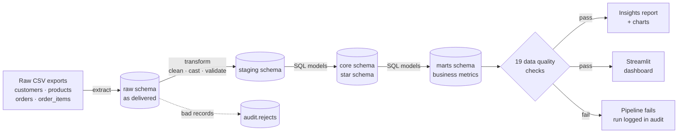
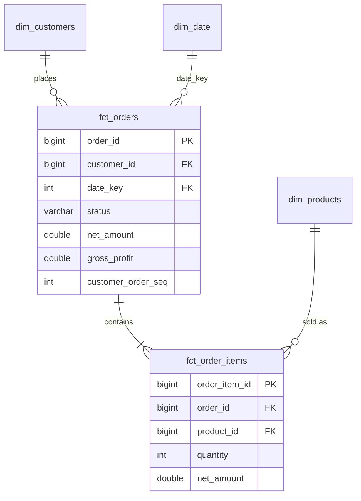
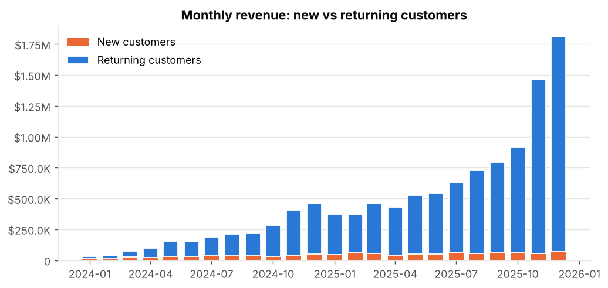
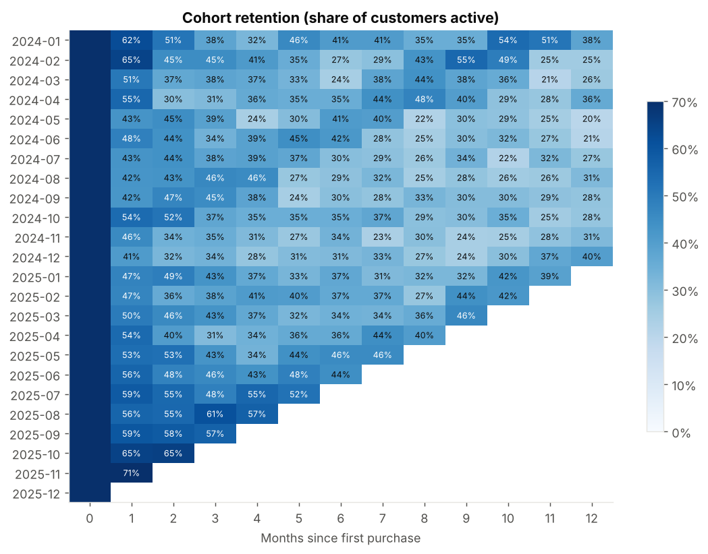
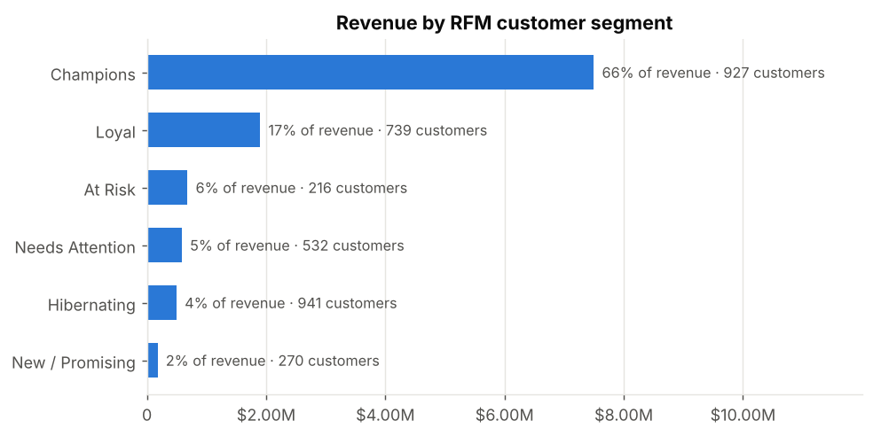
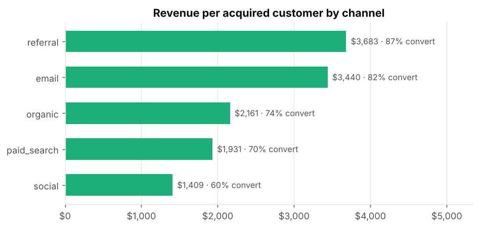

# E-commerce Data Pipeline & Analytics Warehouse


**Live dashboard: [madhubuddaraju.github.io/ecommerce-data-pipeline](https://madhubuddaraju.github.io/ecommerce-data-pipeline/)**

An end-to-end batch data pipeline that turns messy operational exports from an online store into a
tested, analytics-ready warehouse, then answers real business questions on top of it:
**Where does revenue come from? Which customers are we about to lose? Which acquisition channels are worth paying for?**

It covers the full workflow a data engineer / analyst owns: ingestion, cleaning and validation,
dimensional modeling in SQL, automated data quality checks, analysis, a dashboard, and CI.

---

## Architecture



| Layer | Schema | What lives there |
|---|---|---|
| Raw | `raw` | Source files loaded untouched (all text) for lineage and reprocessing |
| Staging | `staging` | Cleaned, typed, de-duplicated records |
| Core | `core` | Star schema: `fct_orders`, `fct_order_items`, `dim_customers`, `dim_products`, `dim_date` |
| Marts | `marts` | `monthly_revenue`, `customer_rfm`, `cohort_retention`, `product_performance`, `channel_performance` |
| Audit | `audit` | `rejects` (every dropped row + reason), `dq_results`, `pipeline_runs` |

### Data model



---

## Key findings

Full, auto-generated report: [`reports/insights.md`](reports/insights.md)

| Metric | Value |
|---|---|
| Revenue (completed orders) | $11.34M |
| Orders / buying customers | 40,499 / 3,625 |
| Average order value | $279.99 |
| Gross margin | 43.2% |

1. **Seasonality dominates.** November-December generate 36% of annual revenue, so inventory and paid
   media should be planned around Q4.
2. **Retention decays steadily.** About 53% of a cohort buys again in month 1, falling to 35% by month 6.
   Post-purchase engagement in the first 30 days is the biggest retention lever.
3. **26% of buyers (Champions) drive 66% of revenue.** Protect them with a loyalty program.
4. **216 high-value customers are At Risk** (~100 days inactive, $681K historical spend), the best
   target for a win-back campaign.
5. **Channel value differs 2.6x.** A referral customer is worth $3,683 vs $1,409 for social, which
   argues for shifting budget toward referral and email.



| Cohort retention | RFM segments |
|---|---|
|  |  |



---

## Quick start

```bash
git clone https://github.com/madhubuddaraju/ecommerce-data-pipeline.git
cd ecommerce-data-pipeline
python -m venv .venv && source .venv/bin/activate
make install

make all          # generate data -> run pipeline -> build report -> run tests
make dashboard    # open the interactive dashboard at http://localhost:8501
```

Without `make`:

```bash
export PYTHONPATH=src
python -m pipeline --generate   # full pipeline run
python analysis/report.py       # charts + insights.md
pytest -q
streamlit run dashboard/app.py
```

A full run (~45K orders, ~86K order lines) takes about 3 seconds on a laptop.

Explore the warehouse directly:

```bash
duckdb data/warehouse.duckdb "SELECT segment, count(*) FROM marts.customer_rfm GROUP BY 1"
```

---

## Data quality

The source data is deliberately messy to mirror real exports:

| Problem in raw data | How it's handled |
|---|---|
| ~1% duplicated order rows (re-sent batches) | Exact-duplicate removal, then `order_id` uniqueness enforced |
| Mixed timestamp formats (`2025-03-01 13:45:00` and `03/01/2025 13:45`) | Explicit multi-format parser; unparseable rows rejected |
| Inconsistent casing / whitespace in emails, countries, statuses | Normalized |
| Missing countries | Filled as `UNKNOWN` (kept, not dropped) |
| Prices stored as `$12.50` strings | Currency symbols stripped, cast to numeric |
| Negative quantities from a buggy client | Rejected with a reason |
| Orphan foreign keys | Rejected with a reason |

Nothing is dropped silently: every rejected row lands in `audit.rejects` with its source table, key and reason.

After the models build, [`src/pipeline/quality.py`](src/pipeline/quality.py) runs 19 checks:
primary-key uniqueness, not-null, referential integrity, accepted values, business rules
(`net_amount <= gross_amount`), and **cross-layer reconciliation** (order totals = sum of lines;
mart revenue = fact revenue). Any `error`-level failure stops the pipeline with a non-zero exit code.

---

## Project structure

```
├── src/pipeline/
│   ├── generate.py      # realistic, intentionally messy source data
│   ├── extract.py       # read raw exports as text
│   ├── transform.py     # clean, cast, validate, collect rejects
│   ├── load.py          # DuckDB loading + SQL model runner
│   ├── quality.py       # declarative data quality checks
│   └── run.py           # orchestrator / CLI, run logging
├── sql/
│   ├── core/            # dimensions and facts (run in filename order)
│   └── marts/           # business-facing aggregates
├── analysis/report.py   # charts + insights.md
├── dashboard/app.py     # Streamlit dashboard with filters
├── tests/               # unit, end-to-end and dashboard smoke tests
├── reports/             # generated report and figures
└── .github/workflows/   # CI: lint, run pipeline, test (Python 3.11 + 3.12)
```

## Design decisions

- **ELT layering (raw → staging → core → marts).** Raw data is kept unchanged so any downstream logic can be
  fixed and replayed without re-ingesting.
- **Python for cleaning, SQL for modeling.** Row-level parsing and validation are easier to unit test in
  pandas; set-based modeling is clearer and faster in SQL.
- **Full-refresh, idempotent builds** (`CREATE OR REPLACE`). Re-running gives identical results, which a
  test enforces. At larger scale the facts would switch to incremental loads keyed on `order_ts`.
- **DuckDB** gives a real columnar SQL warehouse with zero infrastructure. The SQL is standard enough to port
  to Snowflake, BigQuery or Postgres with minor changes.
- **Revenue is defined once** (completed orders, net of discounts, excluding shipping) in `fct_orders`, and
  every mart reads from it, so numbers agree across reports.

## Possible extensions

- Orchestrate with Airflow or Dagster and schedule daily runs
- Port the SQL models to dbt for lineage docs and built-in tests
- Incremental loads and slowly changing dimensions (SCD2) for customer attributes
- Swap the generator for a live source (Shopify API, Postgres CDC)

## About the data

The dataset is synthetic, produced by `src/pipeline/generate.py` with a fixed seed so results are reproducible.
It models realistic behaviour: Pareto-distributed purchase frequency, holiday seasonality, channel-dependent
conversion, product popularity skew, returns and cancellations.

## License

MIT
